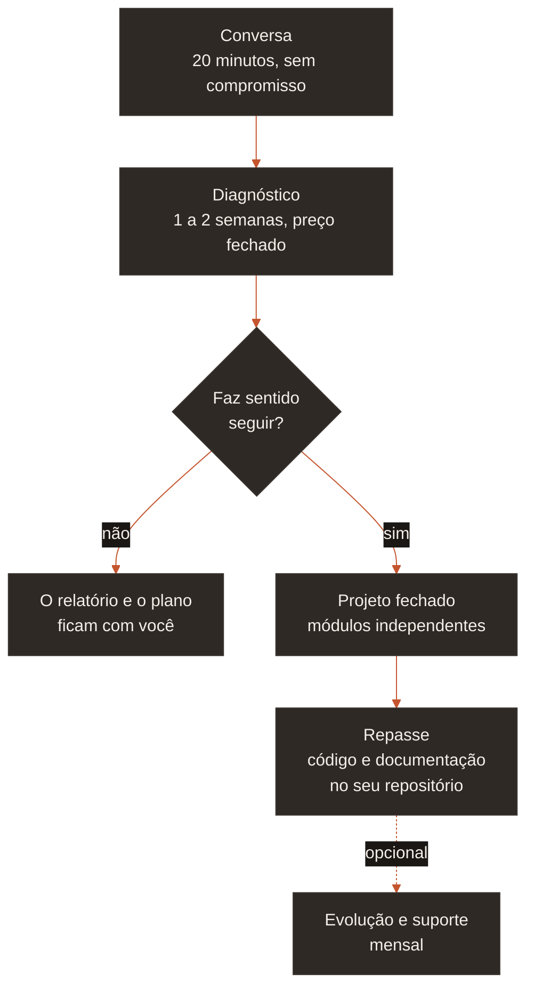

<picture>
  <source media="(prefers-color-scheme: dark)" srcset="assets/banner-escuro.svg">
  
</picture>

Eu trabalho com empresas que já têm uma operação rodando: um ERP, uma central de telefonia, um equipamento em campo. Quando elas precisam de sistema novo em volta disso, eu faço o novo conversar com o que já existe, sem derrubar o banco e sem duplicar regra de negócio.

Sou fundador da **Nzila**, estúdio enxuto de software sob medida. Escrevo em Go, Rust e TypeScript.

## Onde eu entro

| Frente | O problema | O que eu já entreguei |
| --- | --- | --- |
| **Integração com ERP e legado** | Regra de negócio presa em centenas de stored procedures, e todo sistema novo depende de ler tabela do ERP | Serviço lendo ERP corporativo em SQL Server sem degradar a operação, escrita assíncrona por fila e painel operacional em microfrontends |
| **Telecom** | Provisionamento manual e disparo em volume que derruba solução ingênua | Backend de SMS em produção, integração RCS, sistemas ligados a PABX e provisionamento em massa de usuários Asterisk em Go |
| **Sistemas críticos** | Software que não pode falhar, não pode depender de internet e não tem ninguém por perto para reiniciar | Serviço embarcado 100% offline com detecção por geofence e auto-recuperação, motor de trading em Rust com replay determinístico e gateway de pagamento em Go com webhook idempotente |

## Como eu trabalho

O diagnóstico mostra o que existe, onde estão os gargalos e quanto custa resolver. Escopo, prazo e preço ficam por escrito antes de qualquer linha de código.

## Nzila

<picture>
  <source media="(prefers-color-scheme: dark)" srcset="assets/nzila-horizontal-escuro.svg">
  
</picture>

**Nzila** (*n'zi-la*) quer dizer "caminho", em quimbundo. É o estúdio que eu fundei para fazer software sob medida, do levantamento à entrega. Estúdio enxuto, sem fingir time grande: quem conversa com você é quem escreve o código.

> Todo sistema que dura começa num caminho bem traçado.

Fora da Nzila, sou sócio de duas empresas que seguem independentes:

- [WaveHub](https://www.wavehub.dev/): desenvolvimento sob medida em web, mobile, cloud e IoT
- [PiKiTo Pages](https://www.pikitopages.com): landing page montada direto na prévia, para pequeno negócio sair do zero sem escrever código

## Projetos

Código de cliente fica com o cliente. Os produtos marcados como privados estão à venda: o código é fechado, a conversa sobre eles é aberta.

As plataformas Nzila trazem a **Zila**, e o Chairman traz o **Nico**: IAs integradas com personalidade humana, que conversam como gente para quem usa se sentir à vontade desde a primeira mensagem.

| Projeto | O que é | O que mostra |
| --- | --- | --- |
| [Transcriber](https://github.com/samuelrms/transcribe) | App desktop que transcreve qualquer áudio em texto e legenda, 100% no seu computador, para macOS, Windows e Linux | Reunião, entrevista ou áudio sigiloso viram texto em minutos, sem um byte sair da sua máquina. Sem nuvem, sem chave de API, sem termo de uso para ler |
| **Chairman** privado · [ver demonstração](https://barbeariamodelo.samuelramos.dev/demonstracao) | Plataforma white-label para barbearias: site no próprio domínio, agendamento por profissional, confirmação por WhatsApp e e-mail, painel para editar tudo sem código e o Nico, IA integrada, atendendo no WhatsApp | O cliente que lembrou do corte às 22h agenda sozinho em menos de um minuto e recebe a confirmação na hora. O Nico responde dúvida, remarca e chama de volta quem sumiu. Uma base de código, quantas barbearias couberem, cada uma com a própria marca |
| **Nzila Trader** privado | Plataforma que mede 66 combinações de ativo e estratégia em paralelo, com motor em Rust, painel em Next.js e a Zila, IA integrada | Chega de confiar em estratégia que só é bonita no gráfico: cada combinação é ranqueada pelo pior caso que a evidência permite, e você sabe exatamente quantos trades faltam para confiar nela |
| **Nzila Studio** privado | Editor de vídeo operado por conversa com a Zila, IA integrada: você pede a edição em texto e vê cortes, legendas e animações surgindo na timeline em tempo real | Horas de timeline viram uma conversa. Você descreve o vídeo que quer, a Zila monta, e você ainda ajusta qualquer keyframe à mão |
| **Nzila Teleprompter** privado | App de teleprompter para iPhone com câmera, roteiro preparado em conversa por voz com a Zila, IA integrada, e sincronização entre aparelhos | Nunca mais gravar travando no texto: a Zila escreve no seu jeito de falar, marca pausas e ênfases, e o roteiro rola no seu ritmo enquanto a câmera grava |
| **Nzila Payment** privado | Checkout em real e em dólar, avulso, recorrente ou parcelado, com liberação automática de acesso e a Zila, IA integrada | Pagou, acessou: sem planilha, sem conferência manual, sem cliente esperando. Gateway em Go com webhook idempotente e outbox, então nenhum pagamento se perde e nenhum é processado duas vezes |
| [Ferramentas de dado em Go](https://github.com/samuelrms/sanitized_csv) | Sanitização, deduplicação, conversão de moeda e mescla de colunas em CSV e Excel | Aquela planilha gigante que trava o Excel e come a tarde inteira fica limpa em segundos, sempre do mesmo jeito |

## Stack

**Linguagens** · Go · Rust · TypeScript · Python 
**Integração e dados** · SQL Server · PostgreSQL · MongoDB · mensageria (Pub/Sub, transactional outbox) 
**Back-end** · Node.js · NestJS 
**Front-end** · React · Next.js · microfrontends com Module Federation · Tauri 
**Infra** · Docker · GitHub Actions · Linux embarcado 
**Telecom** · Asterisk · SMS · RCS

## Contato

Disponível para diagnóstico técnico e projetos fechados em integração, telecom e sistemas críticos. Escreva contando o problema; eu respondo com o próximo passo.

[E-mail](mailto:samuelaoliveiraramos@gmail.com) · [LinkedIn](https://www.linkedin.com/in/samuelaoramos/) · [Instagram](https://www.instagram.com/samuelramos.tech/) · [samuelramos.dev](https://samuelramos.dev)

English

 

I work with companies that already run on something: an ERP, a phone system, equipment in the field. When they need new software around it, I make the new system talk to the old one without bringing the database down or duplicating business rules.

Founder of **Nzila**, a lean custom-software studio, and partner at [WaveHub](https://www.wavehub.dev/) and [PiKiTo Pages](https://www.pikitopages.com). I write Go, Rust and TypeScript.

- **ERP and legacy integration:** SQL Server, message queues, micro-frontends
- **Telecom:** SMS, RCS, PABX, bulk Asterisk provisioning
- **Critical systems:** offline-first embedded services, deterministic replay, idempotent payments

Open to technical assessments and fixed-scope projects. [Email me](mailto:samuelaoliveiraramos@gmail.com) with the problem.

 

Samuel Ramos · fundador da Nzila
